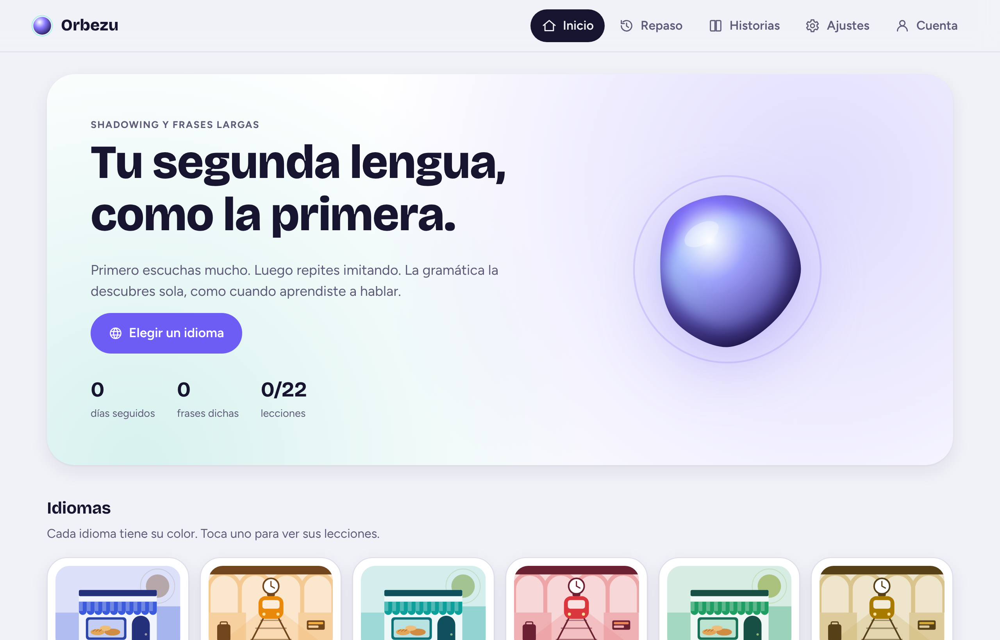
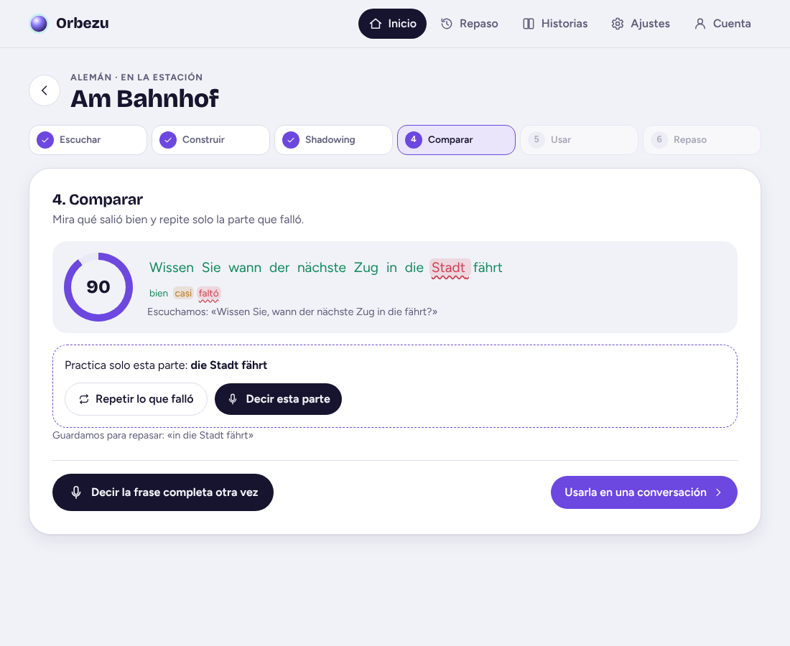
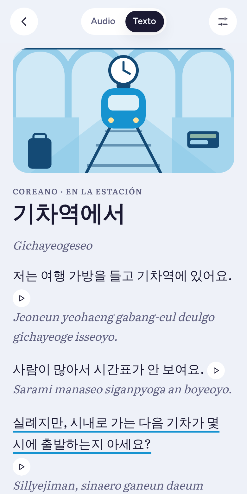
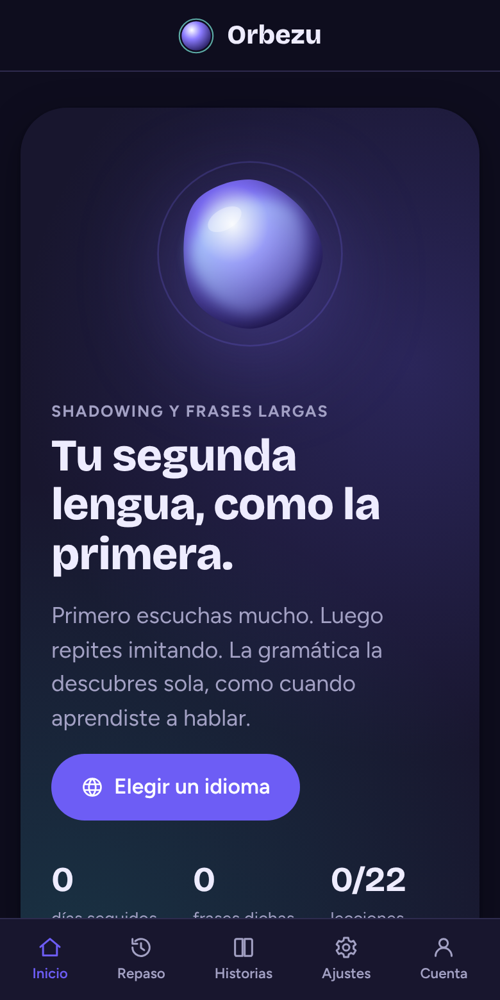

# Orbezu

**Tu segunda lengua, como la primera.**

Orbezu es una app web instalable (PWA) para aprender idiomas hablando en voz alta. Se centra en el *shadowing* y en las frases largas, igual que se aprende la lengua materna: primero escuchas mucho, después repites imitando y la gramática la descubres sin que nadie te la explique al inicio. No es una app de palabras sueltas ni de ejercicios de opción múltiple.



## El método: 6 pasos por lección

1. **Escuchar.** La frase completa suena varias veces dentro de una escena. No hay traducción al inicio: solo aparece si tocas la frase.
2. **Construir de atrás hacia adelante.** La frase larga se arma bloque por bloque desde el final: *on the corner*, luego *at the bakery on the corner*, y así hasta la frase completa. Cada bloque se escucha y se repite hasta que sale fluido.
3. **Shadowing.** Hablas encima del audio, al mismo tiempo, imitando ritmo y entonación. La velocidad empieza en 0.6x y sube hasta 1x.
4. **Comparación.** La app muestra palabra por palabra qué salió bien, qué salió casi bien y qué faltó, y repite solo la parte que falló.
5. **Usar la frase.** Una mini conversación con ramas donde tienes que decir la frase tú solo.
6. **Repaso espaciado.** La frase vuelve días después, justo antes de olvidarla. Las partes donde te equivocaste también se convierten en frases de repaso.

Las historias, las conversaciones y el repaso existen al servicio de este método.

| Comparación palabra por palabra | Lector con ajustes | Modo oscuro en móvil |
| --- | --- | --- |
|  |  |  |

## Qué incluye

- **11 idiomas:** inglés, español, francés, mandarín, portugués (Brasil), árabe, alemán, japonés, coreano, italiano y ruso. Cada idioma tiene su propio color.
- **Romanización** como ayuda en mandarín (pinyin), japonés (rōmaji), coreano (romanización revisada), árabe y ruso (transliteración). Se puede ocultar en Ajustes.
- **22 lecciones guionadas** (2 escenas por idioma) con historia, bloques para construir la frase y un diálogo con ramas. El contenido está pensado para crecer: cada idioma rellena el mismo esqueleto de escena.
- **Orbe de voz animado:** respira en reposo, late cuando la app habla y sigue el volumen de tu micrófono cuando escucha.
- **Lector de historias** con modo Audio o Texto y un panel de ajustes de brillo, tema (Bruma, Crepúsculo, Noche), tamaño de letra e interlineado.
- **Modo libre opcional con Gemini:** cada persona pone su propia API key en Ajustes (modelo configurable, por defecto `gemini-flash-latest`). La key se guarda solo en ese navegador.
- **Modo invitado:** todo funciona sin cuenta y el progreso se guarda en el navegador.
- **Cuentas:** registro e inicio de sesión con correo y contraseña, o con Google. Al iniciar sesión, el progreso de invitado se une con el de la nube sin perder nada.
- **Recordatorios por correo** cuando tienes frases para repasar (node-cron y Resend), que cada persona puede apagar.
- **Instalable** como app (PWA) y con modo oscuro automático.

## Tecnologías

| Parte | Herramientas | Dónde se publica |
| --- | --- | --- |
| Frontend | React 19, Vite, vite-plugin-pwa, Web Speech API | Vercel |
| Backend | Node.js, Express 5, JWT, bcrypt (bcryptjs), Google Identity, node-cron, Resend | Render |
| Base de datos | MySQL | Aiven (en tu PC: XAMPP con MariaDB) |
| Pruebas | Vitest y Testing Library (frontend), Jest y Supertest (backend) | GitHub Actions |

Sobre bcrypt: se usa `bcryptjs`, que es el mismo algoritmo bcrypt escrito en JavaScript. Así no hace falta compilar nada en Windows.

## Estructura

```
orbezu/
  client/                 Frontend (React + Vite, PWA)
    src/data/             Idiomas, escenas y contenido de cada idioma
    src/lib/              Voz, comparación, repaso espaciado, API, sesión
    src/pages/            Inicio, idioma, lección, repaso, historias, ajustes, cuenta
  server/                 Backend (Express 5)
    src/app.js            Rutas de la API
    src/repo.js           Consultas a MySQL
    src/reminders.js      Recordatorios con node-cron
    sql/schema.sql        Tablas
  render.yaml             Configuración para Render
  .github/workflows/      CI y recordatorios diarios
```

## Navegadores

La voz usa la Web Speech API del navegador: síntesis de voz para leer las frases y reconocimiento de voz para escucharte. **Funciona mejor en Chrome y Edge.** En otros navegadores puedes escuchar, y si no hay reconocimiento de voz la app te deja escribir lo que dirías para seguir con la lección. La app lo avisa en pantalla.

Para el shadowing conviene usar audífonos, así el micrófono te oye a ti y no al audio.

Privacidad: el reconocimiento de voz de Chrome envía el audio a los servidores de Google para transcribirlo. En modo libre, lo que dices se envía a Gemini con tu propia API key.

## Ponerlo en marcha en tu PC (Windows, Command Prompt)

Necesitas [Node.js 20 o superior](https://nodejs.org) y [XAMPP](https://www.apachefriends.org) (para MariaDB).

### 1. Base de datos local con XAMPP

Abre el panel de XAMPP y pulsa **Start** en **MySQL**.

### 2. Servidor

```cmd
cd orbezu\server
copy .env.example .env
npm install
npm run db:init
npm run dev
```

`npm run db:init` crea la base de datos `orbezu` y sus tablas en XAMPP. Por defecto usa el usuario `root` sin contraseña, que es lo que trae XAMPP. Si cambiaste eso, edita `DB_USER` y `DB_PASSWORD` en `server\.env`. Cambia también `JWT_SECRET` por una clave larga.

La API queda en `http://localhost:4000`. Puedes comprobarla abriendo `http://localhost:4000/api/health`.

### 3. Frontend

En otra ventana de Command Prompt:

```cmd
cd orbezu\client
copy .env.example .env.local
npm install
npm run dev
```

Abre `http://localhost:5173` en Chrome o Edge.

Si no quieres usar el servidor, deja `VITE_API_URL` vacía en `client\.env.local`: la app funcionará en modo invitado.

### 4. Pruebas

```cmd
cd orbezu\client
npm test

cd ..\server
npm test
```

## Variables de entorno

### Frontend (`client/.env.local` y Vercel)

| Variable | Para qué sirve |
| --- | --- |
| `VITE_API_URL` | Dirección de la API, por ejemplo `https://orbezu-api.onrender.com`. Vacía significa solo modo invitado. |
| `VITE_GOOGLE_CLIENT_ID` | Client ID de Google para el botón "Continuar con Google". Vacía oculta el botón. |

### Backend (`server/.env` y Render)

| Variable | Para qué sirve |
| --- | --- |
| `JWT_SECRET` | Clave para firmar las sesiones. Obligatoria. |
| `CLIENT_ORIGIN` | Direcciones del frontend permitidas, separadas por comas. Acepta comodines, por ejemplo `https://orbezu*.vercel.app` para cubrir todas las direcciones que da Vercel. |
| `DATABASE_URL` | Service URI de Aiven. Si está vacía se usan `DB_HOST`, `DB_PORT`, `DB_USER`, `DB_PASSWORD` y `DB_NAME`. |
| `DB_SSL_CA` | Contenido del certificado `ca.pem` de Aiven, para que la conexión sea cifrada y verificada. |
| `GOOGLE_CLIENT_ID` | El mismo Client ID del frontend. El servidor lo usa para verificar el token de Google. |
| `RESEND_API_KEY` | Clave de Resend. Sin ella, los correos solo se muestran en la consola. |
| `EMAIL_FROM` | Remitente de los correos. |
| `APP_URL` | Dirección pública del frontend, para los enlaces de los correos. |
| `REMINDER_CRON`, `REMINDER_TZ` | Cuándo se envían los recordatorios (por defecto, 9:00 en Lima). |
| `CRON_SECRET` | Clave para lanzar los recordatorios desde GitHub Actions. |

## Publicarlo

### 1. Base de datos en Aiven

1. Crea un servicio **MySQL** en [Aiven](https://console.aiven.io).
2. En la página del servicio copia la **Service URI** y descarga el **CA certificate**.
3. Crea las tablas desde tu PC. En `server\.env` pon `DATABASE_URL` con la Service URI y `DB_SSL_CA` con el contenido del certificado, y ejecuta:

```cmd
cd orbezu\server
npm run db:init
```

### 2. Inicio de sesión con Google

1. En [Google Cloud Console](https://console.cloud.google.com/apis/credentials) crea un **ID de cliente de OAuth** de tipo **Aplicación web**.
2. En **Orígenes autorizados de JavaScript** agrega `http://localhost:5173` y la dirección de tu frontend en Vercel.
3. Usa ese Client ID en `VITE_GOOGLE_CLIENT_ID` (Vercel) y en `GOOGLE_CLIENT_ID` (Render).

### 3. API en Render

1. En [Render](https://dashboard.render.com) elige **New > Blueprint** y conecta este repositorio. Render lee `render.yaml` y crea el servicio `orbezu-api` con la carpeta `server`.
2. Completa las variables que piden valor: `CLIENT_ORIGIN`, `DATABASE_URL`, `DB_SSL_CA`, `GOOGLE_CLIENT_ID`, `RESEND_API_KEY`, `EMAIL_FROM` y `APP_URL`. `JWT_SECRET` y `CRON_SECRET` se generan solas.

En el plan gratuito de Render el servidor se duerme cuando no recibe visitas, y mientras duerme node-cron no se ejecuta. Por eso hay un respaldo: el workflow `Recordatorios diarios` de GitHub Actions llama a la API una vez al día. Para activarlo, agrega en GitHub (Settings > Secrets and variables > Actions) los secretos `ORBEZU_API_URL` (la dirección de Render) y `CRON_SECRET` (el mismo valor que tiene Render).

### 4. Frontend en Vercel

1. En [Vercel](https://vercel.com/new) importa este repositorio.
2. En **Root Directory** elige `client`. Vercel detecta Vite solo.
3. Agrega `VITE_API_URL` y `VITE_GOOGLE_CLIENT_ID` y publica.

### 5. Correos con Resend

Crea una API key en [Resend](https://resend.com). Con el remitente de prueba `onboarding@resend.dev`, Resend solo entrega correos a la dirección de tu propia cuenta. Para enviar a cualquier persona, verifica un dominio en Resend y úsalo en `EMAIL_FROM`.

## API

| Método | Ruta | Descripción |
| --- | --- | --- |
| `POST` | `/api/auth/register` | Crea una cuenta con nombre, correo y contraseña. |
| `POST` | `/api/auth/login` | Inicia sesión con correo y contraseña. |
| `POST` | `/api/auth/google` | Inicia sesión o crea la cuenta con Google. Si ya existe una cuenta con ese correo, la vincula. |
| `GET` | `/api/auth/me` | Devuelve la cuenta actual. |
| `PATCH` | `/api/auth/me` | Cambia el nombre o los recordatorios. |
| `DELETE` | `/api/auth/me` | Elimina la cuenta y su progreso. |
| `GET` / `PUT` | `/api/progress` | Lee o guarda el progreso. |
| `POST` | `/api/cron/reminders` | Envía los recordatorios pendientes (requiere `x-cron-secret`). |
| `GET` | `/api/health` | Estado del servidor y de la base de datos. |

Las rutas privadas usan `Authorization: Bearer <token>`.

## Agregar una lección

1. Si es una escena nueva, define su esqueleto en `client/src/data/scenes.js`: el orden de la historia, cuál es la frase objetivo y el diálogo con sus ramas, más la traducción al español (y al inglés para quien aprende español).
2. En cada archivo de `client/src/data/content/` agrega el texto de esa escena en el idioma, con su romanización cuando corresponda, y los bloques para construir la frase de atrás hacia adelante.
3. Agrega el nombre de la escena a `SCENE_ORDER`.
4. Ejecuta `npm test`: las pruebas comprueban que cada bloque esté dentro de la frase, que los bloques crezcan y que haya romanización donde hace falta.

## Licencia

MIT
